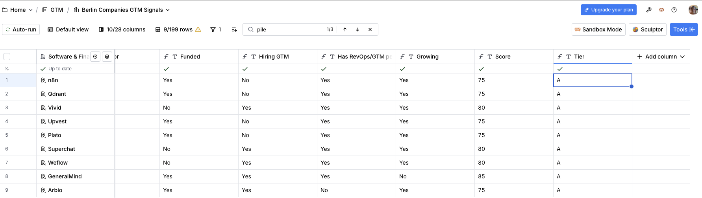
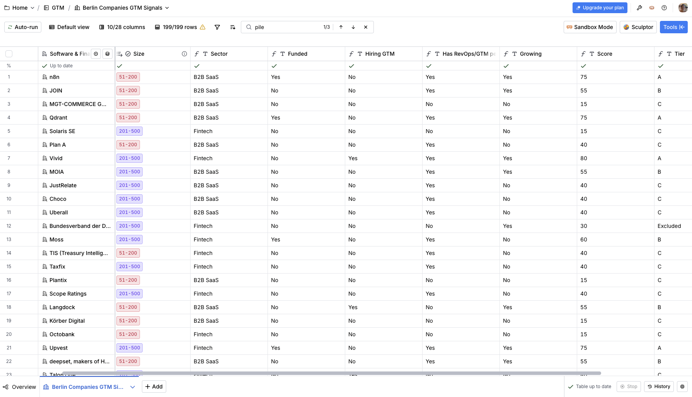
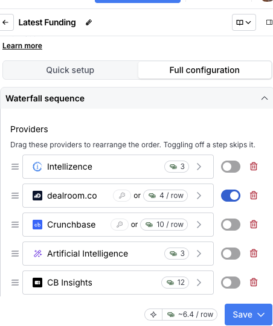
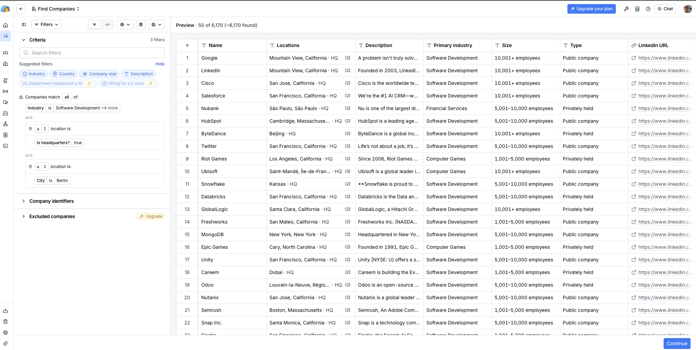
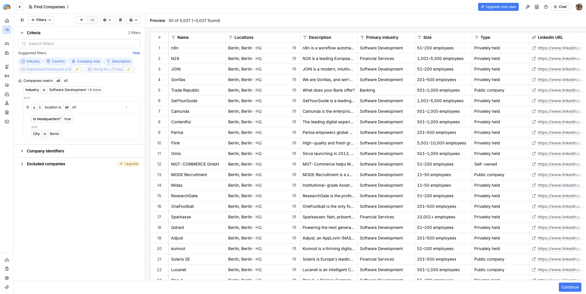
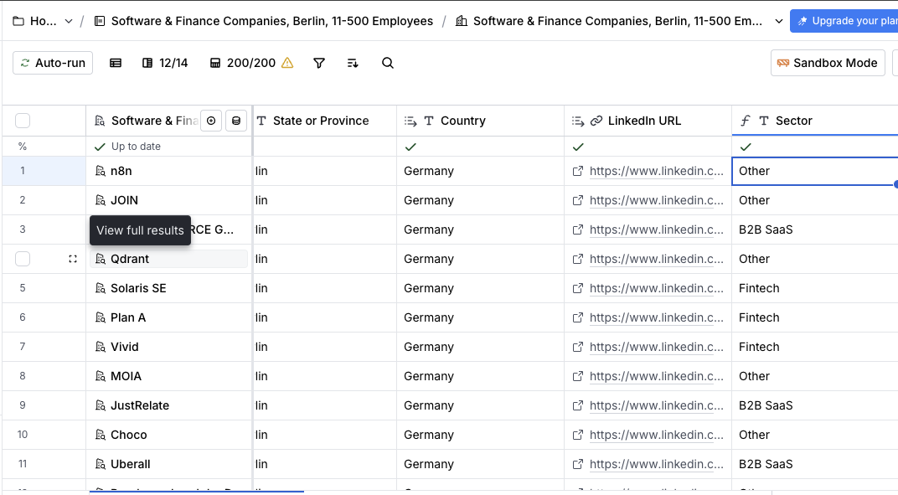
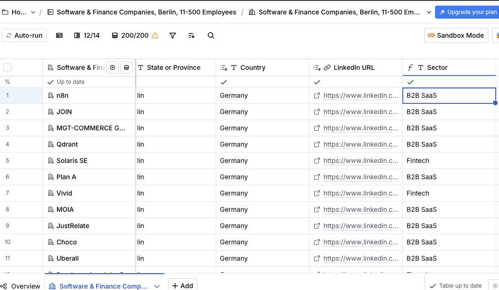

# Berlin startup scoring with Clay

A scored target account list of Berlin tech startups, built in Clay on a free plan. It goes from a search of 10,904 companies to 9 Tier A accounts, using five signals and a budget of about 180 credits.

I used my own criteria for a good employer as the ICP: Berlin-based, English-speaking, fintech or B2B SaaS, an existing GTM team, room to grow. That way every scoring decision is one I can explain from first-hand reasoning.

Every decision, including the ones I changed and the things that broke, is in [`notes/decisions.md`](notes/decisions.md).

## Results

| Tier | Companies | Share |
|---|---|---|
| A (70+) | 9 | 5% |
| B (50–69) | 23 | 12% |
| C (below 50) | 159 | 80% |
| Excluded | 8 | 4% |

199 companies scored (200 sourced, 1 duplicate removed). Full list: [`data/scored_companies.csv`](data/scored_companies.csv).

## 1. Sourcing: 10,904 → 200

| Step | Companies |
|---|---|
| Clay company search: Berlin + tech industries | 10,904 |
| Headquarters in Berlin (first attempt, logic bug) | 6,170 |
| Headquarters in Berlin (fixed) | 5,037 |
| 11–500 employees | 1,496 |
| Description mentions B2B, SaaS, fintech, payments, banking... | 593 |
| Imported into a Clay table (plan limit: 200 rows) | 200 |

- **Headquarters, not offices.** The first search was full of global companies with a Berlin sales office. I wanted companies run from Berlin.
- **11–500 employees.** Startups and scale-ups. Below 11, companies almost never have a GTM team, so they would all land in Tier C.
- **Sector keywords.** GTM and RevOps roles exist mostly at B2B companies. Fintech terms keep consumer fintechs in.
- **The 200-row limit.** Clay imported 200 of the 593 in its own order. The list is a sample, not the full 593.

## 2. Scoring model

**Filters (excluded before scoring):** non-profits, and companies whose GTM job posts are in German.

| Signal | Why it matters | Points |
|---|---|---|
| Hiring for a GTM / RevOps role | The company is building its GTM function now | 25 |
| Has a RevOps / GTM / Sales Ops person | There's a team and processes to learn from | 25 |
| Funding round in the last ~12 months | Budget for GTM tools and people | 20 |
| Headcount up 10%+ in 12 months | Room to take on new scope | 15 |
| Fintech or B2B SaaS (other tech: 5) | Preferred sectors | 15 |

I gave the top two signals equal weight. An active GTM build-out and an existing team to learn from matter equally; neither alone makes a great fit.

## 3. How each signal was built

| Signal | How | Cost | Result |
|---|---|---|---|
| Sector | Formula on industry + description keywords | 0 | 121 B2B SaaS, 76 Fintech, 2 other |
| Funding | Formula: match against a list I built from free public sources | 0 | 10 of 199 (5%) |
| Hiring GTM | Clay "Find active job openings", GTM title keywords + formula check | 0.5 per hit | 13 companies |
| Job language | Formula: German job words in the title | 0 | 17 English, 1 German |
| RevOps / GTM person | Clay "Find contacts at company" + strict title check | 0.5 per hit | 101 returned → 63 confirmed |
| Headcount growth | Clay "Find company headcount growth" | 0.5 per row | Data for 186 of 200 (93%), 67 growing 10%+ |

## 4. Working within ~180 credits

The cheapest paid funding option was 3 credits per row (600 for 200 companies); the funding waterfall was ~6.4 per row. So I ordered the work by cost:

1. **Free first.** Sector, funding, language and the final score are all formula columns.
2. **Cheap single providers, not waterfalls.** Jobs, contacts and headcount each cost 0.5. Waterfalls for the same data cost 2–4 per row.
3. **Test on 10 rows before every paid run.** This caught an invalid setting (job limit above 10) and a weak keyword setup before they cost credits.

Total spent on enrichment: about **96 credits for 200 companies**. Clay only charged the jobs and contacts searches when they found something.

## 5. What broke, and how I fixed it

**The headquarters filter.** I added "location is headquarters" and "location is Berlin" as two separate conditions. Clay checks each one on its own, so Google (HQ in Mountain View, office in Berlin) passed both. The count only fell from 10,904 to 6,170. Fix: both conditions in the same location rule.

**The sector formula.** My first version used only description keywords. A spot-check of 11 rows found 5 wrong: n8n, JOIN, Qdrant and Choco were "Other" because their descriptions never say "SaaS" or "B2B". Fix: use the industry field first, keywords only as a backup. 10 of 11 correct after the fix.

**The contact search.** Clay found a person at 10 of 10 test companies, but only about 6 were real RevOps/GTM roles. The others were a founder, an advisor and a general operations manager. Fix: a formula re-checks the returned job title. Across all 200, it removed 38 of 101 matches.

**The hiring keywords.** Spot-checking Tier A, I found "Growth" had matched marketing roles ("Growth Marketing Manager"). 3 of the 12 Tier A companies were there partly because of a marketing job. I also found one company listed twice (a subsidiary under its own name). Fix: ignore titles containing "marketing" and remove the duplicate. Tier A went from 12 to 9.

**Lesson across all four:** an enrichment returning a result doesn't mean the result is right. A cheap check on the output caught most of these.

## 6. Limitations

- **Funding coverage is thin.** The free list covers rounds from October 2025 onward. Well-funded companies that raised in 2024 show "No".
- **Hiring is not location-filtered.** A few matched jobs are outside Berlin (e.g. remote US roles).
- **One strong signal isn't enough.** A company hiring a "Revenue Operations Specialist", exactly the target role, scores 40 (Tier C) because its other signals are missing.
- **Keyword-based tags.** "Software Development" also covers consumer apps, which get tagged B2B SaaS.
- **Sample, not the full market.** Clay chose which 200 of the 593 to import.

## 7. What I'd do next

- A "direct hit" rule: an open role matching the exact target title goes straight to Tier A or B.
- A paid funding column for Tier A and B only, to close the 2024 gap where it matters.
- Location filter on the job search (Berlin or remote-EU).
- A second source (e.g. public lists of recently funded startups) and a benchmark: of companies I already know are good, how many does the sourcing find?

## Files

- `notes/decisions.md`: every decision, with the reasoning and what changed
- `data/scored_companies.csv`: 199 companies with all signals, scores and tiers
- `scripts/apply_spotcheck_fixes.py`: the two fixes from the Tier A spot-check, applied to the Clay export
- `screenshots/`: the Clay setup at key steps

No personal data is in this repo. Contact searches were used only to answer "yes/no", and no names were exported.
